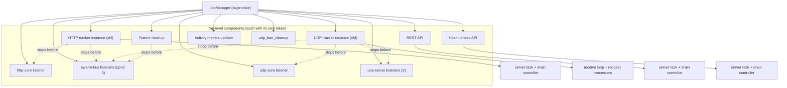
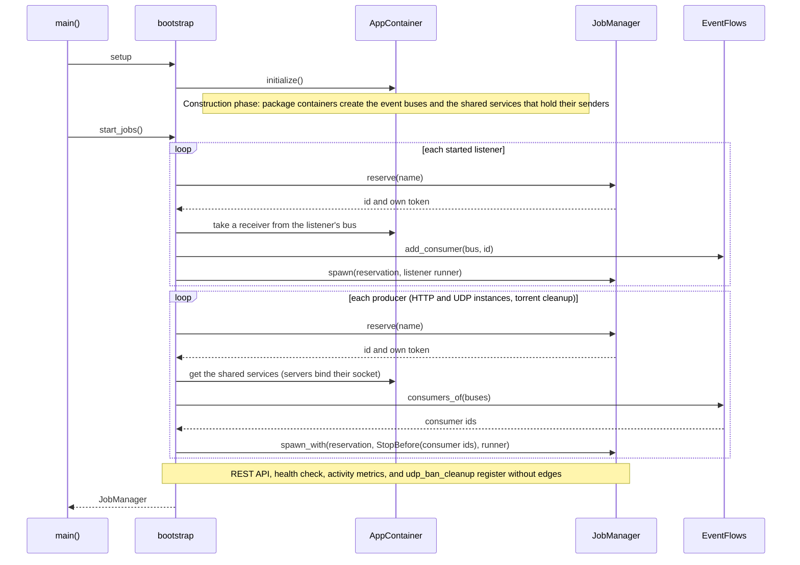
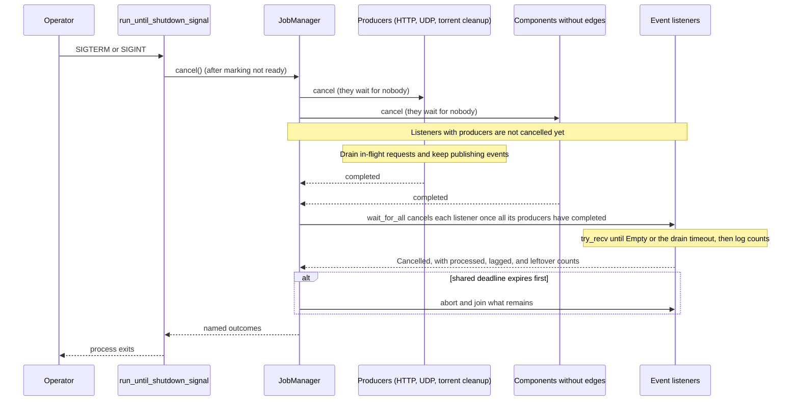
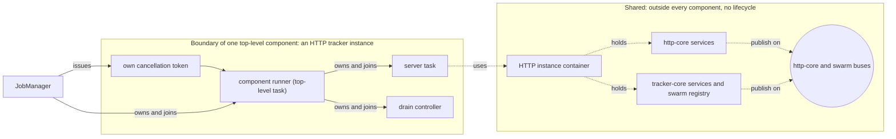

---
semantic-links:
  skill-links:
    - write-markdown-docs
  related-artifacts:
    - issue #1453
    - issue #1488
    - src/main.rs
    - src/app.rs
    - src/bootstrap/app.rs
    - src/bootstrap/jobs/
    - src/bootstrap/event_flows.rs
    - src/bootstrap/jobs/manager.rs
    - packages/hung-component-tracker/tests/hung_component_abort.rs
    - src/bootstrap/jobs/udp_tracker_server.rs
    - docs/adrs/20261021184946_order_shutdown_by_event_flow_and_drain_event_listeners.md
    - docs/architecture/events.md
    - src/container.rs
    - packages/udp-core/src/container.rs
    - packages/udp-core/src/services/banning.rs
    - packages/udp-server/src/server/launcher.rs
---

# Application Jobs and Task Ownership

This document describes the tracker application's **current implementation** of
background jobs and task ownership, including the shutdown order of event
producers and event listeners. This is the shutdown architecture delivered by
[shutdown-overhaul EPIC #1488](../issues/closed/1488-overhaul-tracker-shutdown/EPIC.md),
which was closed on 2026-11-18.
The decision behind the shutdown order is the
[shutdown-order ADR](../adrs/20261021184946_order_shutdown_by_event_flow_and_drain_event_listeners.md);
the event buses are described in [Events Architecture](events.md).

## Terms

The terms used here (direct component, owner, service, instance,
unmanaged task) are defined once in the [glossary](glossary.md).

## Current Bootstrap Flow

1. `main` calls `app::start`.
2. `bootstrap::app::setup` loads configuration, initializes shared services,
   and constructs `AppContainer`.
3. `app::start` loads required persisted data, then `start_jobs` creates a
   `JobManager` and an `EventFlows` registry and starts application jobs and
   service instances: first every event listener, then the components that
   publish events (see [Startup sequence](#startup-sequence)).
4. `main` then calls `app::run_until_shutdown_signal`. On `Ctrl+C` or
   `SIGTERM` it calls `app::begin_shutdown` (mark not ready, then
   `JobManager::cancel`), waits for registered direct components through
   `JobManager::wait_for_all` under one process-wide deadline
   (`application.shutdown.deadline_in_secs`, 25 seconds by default), and maps
   the outcomes to the process exit code
   (see [Shutdown sequence](#shutdown-sequence)).

### Supervision Tree and Stop Order

Solid arrows are ownership: `JobManager` owns the top-level components, and each
component owns and joins its child tasks. Dashed arrows are the stop-before
edges that bootstrap declares through `EventFlows`: the component at the arrow's
tail completes before the component at its head is asked to stop. Components
without an incoming edge are asked to stop as soon as shutdown starts.

The two udp-server listeners exist only when the UDP tracker services start, and
the swarm-bus listeners only under their configuration. A listener that no
started producer publishes to, such as the udp-core listener when no UDP tracker
is configured, has no incoming edge.

### Startup Sequence

The construction phase builds services through constructors, in dependency order,
with no lifecycle. The execution phase registers components: every listener
first, so no event is published before its consumer exists, then the producers.
`EventFlows` rejects a consumer registered after a producer of its bus.

### Shutdown Sequence

A listener is asked to stop as soon as every producer of its buses has
completed; for example, the UDP listeners can stop while an HTTP drain is still
running.

`cancel()` logs which components it asked to stop and which wait for others,
with a `waiting_for` field; `wait_for_all` logs each release with the
`last_completed_job` that caused it. A failed or panicked producer releases its
listeners too, and its failure stays in the outcomes. Completion of a producer
before `cancel()` never cancels a listener by itself.

A component that never completes is aborted when the shared deadline expires,
and so is the health check API, which stops last and therefore is never asked to
stop; the process exits with code 1 and names both in `incomplete_components`.
The test-only `packages/hung-component-tracker` crate verifies this on a real
tracker process for `SIGTERM` and `SIGINT`. The abort only takes effect at an
await point: a component that blocks its thread is not stopped by it.

### Boundary of One Component

An HTTP tracker instance as an example of where a component ends. Everything
inside the box stops on the component's one token and is joined before the
component reports its outcome. Everything outside is shared: the component only
uses it, and never stops it.

## Current Ownership Rule

Every spawned task has an explicit owner. Bootstrap registers each direct
component in two steps: `JobManager::reserve` issues the component its own
`CancellationToken`, bootstrap builds the component's runner with it, and
`JobManager::spawn` creates and owns the component's task in its `JoinSet`, so
it never receives a `JoinHandle` from the component. A reservation dropped
without being spawned, for example after a bind failure, is released. Components
retain ownership of their nested server handles and must signal, join, or
deliberately abort them before completion. Every job is a reserved component;
there is no legacy registration path. The HTTP tracker, REST API and health-check API components
share one supervisor (`bootstrap/jobs/token_aware_server.rs`): it joins the server task, always joins
the drain controller, and only then maps the errors, so a failed server join never loses the drain
outcome. The UDP receive loop has its own supervisor, because it owns one task and no drain controller.

`JobManager::spawn_with` additionally takes `StopBefore` edges naming the
components the spawned component must complete before they are asked to stop;
`spawn` is the same without edges. Edges can only name components reserved
earlier in the same manager, so the graph has no cycle. A registration that names
an unknown, released, foreign, or later component or itself, or that adds edges
after `cancel()`, is rejected without leaving state behind. A component that waits
for nobody can still be spawned after `cancel()`, with a cancelled token; a stop-before
target reserved before `cancel()` keeps its uncancelled token until the components
that stop before it have completed.

`JobManager::cancel` requests cooperative shutdown: it cancels the token of every
component that does not wait for another. No component token is derived from another (issue #2415), which
is what lets the manager cancel components at different times. `wait_for_all`
cancels each remaining component once the last component it waits for has
completed in any state, and applies one common deadline concurrently to direct
components. On expiry it aborts and joins all
remaining work, including components that were never asked to stop, and logs
what each was still waiting for; direct components use drop-safe cleanup to
prevent a nested server from becoming detached when the outer component is
aborted.

Bootstrap does not declare edges one by one. `EventFlows` (`src/bootstrap/event_flows.rs`)
records which listeners consume each event bus and derives each producer's edges
from the buses it publishes on (see [Events Architecture](events.md)).

The job's ownership follows the lifetime of the **service or data it operates
on**, not merely the listener that happened to start it. A shared service has
one application-owned job; an instance-owned service can have one instance-owned
job.

## IP-Ban Cleanup Example

Issue #1453 applies this ownership rule to the UDP IP-ban cleanup task.

`UdpTrackerCoreServices` owns one `BanService` shared by every configured UDP
tracker instance. Previously, each UDP listener launcher spawned a cleanup task
for that same shared service. With multiple UDP listeners, the application
therefore ran multiple cleanup tasks that reset the same ban data.

The UDP listener instances, their event-listener jobs, and the cleanup task now
start as one configuration-gated UDP service group. The cleanup task is one
application-owned `udp_ban_cleanup` job:

- `app::start_jobs` starts the group only when UDP listeners are requested and
  allowed: at least one is configured and the tracker is not in private mode.
- It reserves the job with `JobManager::reserve` and spawns it before starting UDP listener
  instances.
- It runs with the reservation's token and exits cooperatively when cancellation is requested. The
  manager's stop-last edge makes it stop before the health check; it publishes no event, so it has no
  event-flow edge.
- The listener launcher no longer spawns cleanup tasks.

This is a concrete improvement in lifecycle control, but it does not imply that
all jobs already follow the desired ownership model.

## Scope and Limits of the Supervisor

The `JobManager` directly owns named component futures in a `JoinSet`. It gives
each component its own `CancellationToken`, requests cancellation in the declared
stop order, waits for all components under one shared shutdown deadline, aborts
and joins what remains at the deadline, and returns one named outcome per
component (completed, cancelled, failed, panicked or aborted). The process exit
code is derived from those outcomes.

The supervision has two levels, not a general tree. The manager knows only the
top-level components; each component owns, cancels and joins its own nested
tasks, and the manager never sees their handles.

The manager supervises shutdown only. It deliberately does not provide:

- a restart policy: a component that fails or panics while the tracker runs is
  not restarted, and its outcome is collected at shutdown;
- runtime state reporting: it can name the components still waiting to be asked
  to stop, but it does not publish the state of each component while it runs;
- dynamic lifecycle: components are started during startup and stopped at
  shutdown, not started or stopped on request; and
- communication between parent and child beyond the cancellation token and the
  final outcome.

None of these is planned. Shutdown-overhaul EPIC #1488 placed dynamic job
lifecycle out of its scope and is closed. Changes to this document should
describe verified current behavior.
