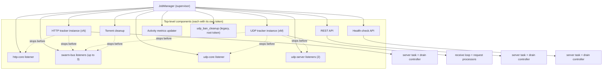
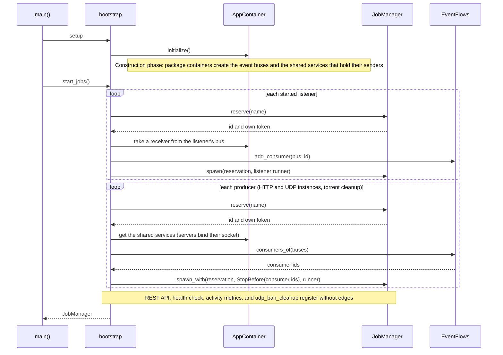
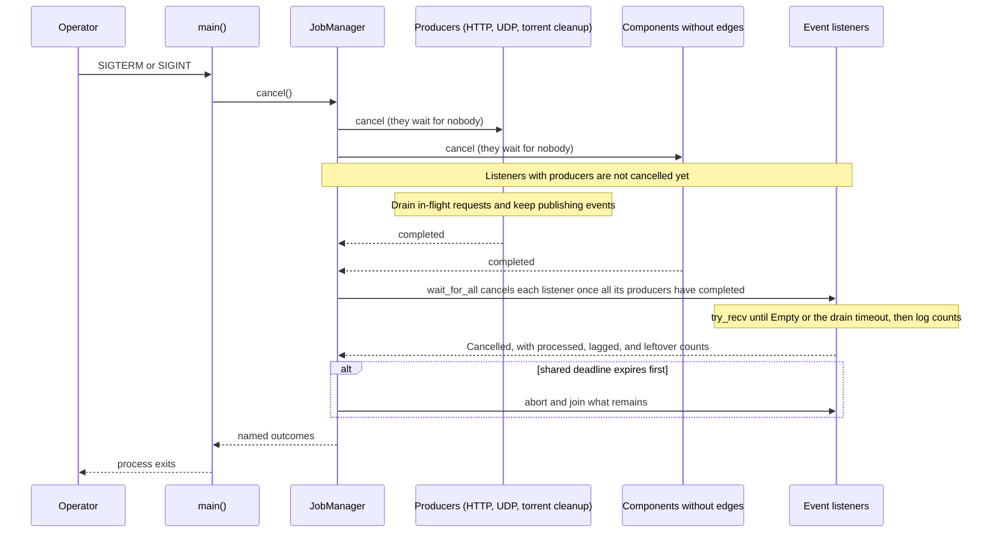
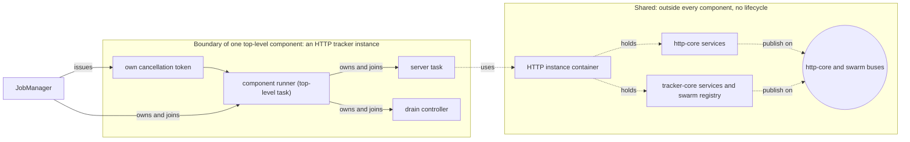

---
semantic-links:
  skill-links:
    - write-markdown-docs
  related-artifacts:
    - issue #1453
    - issue #1488
    - src/main.rs
    - src/app.rs
    - src/bootstrap/app.rs
    - src/bootstrap/jobs/
    - src/bootstrap/event_flows.rs
    - src/bootstrap/jobs/manager.rs
    - src/bootstrap/jobs/udp_tracker_server.rs
    - docs/adrs/20261021184946_order_shutdown_by_event_flow_and_drain_event_listeners.md
    - docs/architecture/events.md
    - src/container.rs
    - packages/udp-core/src/container.rs
    - packages/udp-core/src/services/banning.rs
    - packages/udp-server/src/server/launcher.rs
---

# Application Jobs and Task Ownership

This document describes the tracker application's **current implementation** of
background jobs and task ownership, including the shutdown order of event
producers and event listeners. It is not the final shutdown architecture: the
rest of the design is being developed in
[shutdown-overhaul EPIC #1488](https://github.com/torrust/torrust-tracker/issues/1488)
and its [draft PR #1993](https://github.com/torrust/torrust-tracker/pull/1993).
The decision behind the shutdown order is the
[shutdown-order ADR](../adrs/20261021184946_order_shutdown_by_event_flow_and_drain_event_listeners.md);
the event buses are described in [Events Architecture](events.md).

## Terms

The terms used here (direct component, legacy job, owner, service, instance,
unmanaged task) are defined once in the [glossary](glossary.md).

## Current Bootstrap Flow

1. `main` calls `app::start`.
2. `bootstrap::app::setup` loads configuration, initializes shared services,
   and constructs `AppContainer`.
3. `app::start` loads required persisted data, then `start_jobs` creates a
   `JobManager` and an `EventFlows` registry and starts application jobs and
   service instances: first every event listener, then the components that
   publish events (see [Startup sequence](#startup-sequence)).
4. On `Ctrl+C` or `SIGTERM`, `main` calls `JobManager::cancel`, then waits for
   registered direct components and transitional legacy jobs through
   `JobManager::wait_for_all` under one ten-second process-wide grace period
   (see [Shutdown sequence](#shutdown-sequence)).

### Supervision Tree and Stop Order

Solid arrows are ownership: `JobManager` owns the top-level components, and each
component owns and joins its child tasks. Dashed arrows are the stop-before
edges that bootstrap declares through `EventFlows`: the component at the arrow's
tail completes before the component at its head is asked to stop. Components
without an incoming edge are asked to stop as soon as shutdown starts.

The two udp-server listeners exist only when the UDP tracker services start, and
the swarm-bus listeners only under their configuration. A listener that no
started producer publishes to, such as the udp-core listener when no UDP tracker
is configured, has no incoming edge.

### Startup Sequence

The construction phase builds services through constructors, in dependency order,
with no lifecycle. The execution phase registers components: every listener
first, so no event is published before its consumer exists, then the producers.
`EventFlows` rejects a consumer registered after a producer of its bus.

### Shutdown Sequence

A listener is asked to stop as soon as every producer of its buses has
completed; for example, the UDP listeners can stop while an HTTP drain is still
running.

`cancel()` logs which components it asked to stop and which wait for others,
with a `waiting_for` field; `wait_for_all` logs each release with the
`last_completed_job` that caused it. A failed or panicked producer releases its
listeners too, and its failure stays in the outcomes. Completion of a producer
before `cancel()` never cancels a listener by itself.

### Boundary of One Component

An HTTP tracker instance as an example of where a component ends. Everything
inside the box stops on the component's one token and is joined before the
component reports its outcome. Everything outside is shared: the component only
uses it, and never stops it.

## Current Ownership Rule

Every spawned task has an explicit owner. Bootstrap registers each direct
component in two steps: `JobManager::reserve` issues the component its own
`CancellationToken`, bootstrap builds the component's runner with it, and
`JobManager::spawn` creates and owns the component's task in its `JoinSet`, so
it never receives a `JoinHandle` from the component. A reservation dropped
without being spawned, for example after a bind failure, is released. Components
retain ownership of their nested server handles and must signal, join, or
deliberately abort them before completion. The narrow legacy registry retains
only the pre-spawned periodic handles that cannot be adopted by a `JoinSet`
without a wrapper task.

`JobManager::spawn_with` additionally takes `StopBefore` edges naming the
components the spawned component must complete before they are asked to stop;
`spawn` is the same without edges. Edges can only name components reserved
earlier in the same manager, so the graph has no cycle. A registration that names
an unknown, released, foreign, or later component or itself, or that adds edges
after `cancel()`, is rejected without leaving state behind. A component that waits
for nobody can still be spawned after `cancel()`, with a cancelled token; a stop-before
target reserved before `cancel()` keeps its uncancelled token until the components
that stop before it have completed.

`JobManager::cancel` requests cooperative shutdown: it cancels the legacy root
token that only legacy jobs use, and the token of every component that does not
wait for another. No component token is derived from another (issue #2415), which
is what lets the manager cancel components at different times. `wait_for_all`
cancels each remaining component once the last component it waits for has
completed in any state, and applies one common deadline concurrently to direct
components and retained legacy handles. On expiry it aborts and joins all
remaining work, including components that were never asked to stop, and logs
what each was still waiting for; direct components use drop-safe cleanup to
prevent a nested server from becoming detached when the outer component is
aborted.

Bootstrap does not declare edges one by one. `EventFlows` (`src/bootstrap/event_flows.rs`)
records which listeners consume each event bus and derives each producer's edges
from the buses it publishes on (see [Events Architecture](events.md)).

The job's ownership follows the lifetime of the **service or data it operates
on**, not merely the listener that happened to start it. A shared service has
one application-owned job; an instance-owned service can have one instance-owned
job.

## IP-Ban Cleanup Example

Issue #1453 applies this ownership rule to the UDP IP-ban cleanup task.

`UdpTrackerCoreServices` owns one `BanService` shared by every configured UDP
tracker instance. Previously, each UDP listener launcher spawned a cleanup task
for that same shared service. With multiple UDP listeners, the application
therefore ran multiple cleanup tasks that reset the same ban data.

The UDP listener instances, their event-listener jobs, and the cleanup task now
start as one configuration-gated UDP service group. The cleanup task is one
application-owned `udp_ban_cleanup` job:

- `app::start_jobs` starts the group only when UDP listeners are requested and
  allowed: at least one is configured and the tracker is not in private mode.
- It registers the cleanup job with `JobManager` before starting UDP listener
  instances.
- It receives the manager's legacy root token (`JobManager::legacy_cancellation_token`) and exits cooperatively
  when cancellation is requested.
- The listener launcher no longer spawns cleanup tasks.

This is a concrete improvement in lifecycle control, but it does not imply that
all jobs already follow the desired ownership model.

## Current Limitations and Future Work

The current `JobManager` directly owns named component futures in a `JoinSet`
and keeps a narrow compatibility registry only for the pre-spawned UDP
ban-cleanup periodic job. All of those tasks share one shutdown deadline, but
the legacy job is not a direct `JoinSet` component. It is transitional until
the UDP ban-cleanup periodic-job migration is complete.

It is not yet a complete task-supervision system.

In particular, the current architecture does not yet define a complete hierarchy
of parent and child jobs, uniform cancellation support for every job, state
reporting, restart policy, or richer parent-child communication. Those concerns
belong to shutdown-overhaul EPIC #1488 and draft PR #1993. Changes to this
document should describe verified current behavior until that design is accepted.
