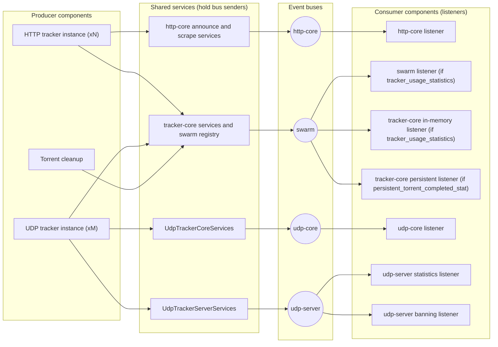

---
semantic-links:
  skill-links:
    - write-markdown-docs
  related-artifacts:
    - docs/architecture/README.md
    - docs/architecture/tracker-instance-architecture.md
    - docs/adrs/20260727000000_events_are_objective_facts.md
    - docs/adrs/20260727180000_shared_services_across_tracker_instances.md
    - packages/events/src/bus.rs
    - packages/http-core/src/container.rs
    - packages/udp-core/src/container.rs
    - packages/udp-server/src/container.rs
    - packages/swarm-coordination-registry/src/container.rs
    - docs/adrs/20261021184946_order_shutdown_by_event_flow_and_drain_event_listeners.md
    - docs/architecture/application-jobs.md
    - docs/architecture/glossary.md
    - src/container.rs
    - src/app.rs
    - src/bootstrap/event_flows.rs
    - src/bootstrap/jobs/
    - issue #2039
    - issue #2035
    - issue #2036
---

# Events Architecture

## Purpose

This guide describes the tracker event topology and the direction for
normalizing per-listener metrics policy. It distinguishes an event producer's
responsibility to report an objective fact from a listener's responsibility to
apply a policy to that fact.

## Current Topology

`EventBus` wraps a Tokio broadcast channel and returns no sender when its
`SenderStatus` is disabled. This remains useful for explicit absent-sender
injection and for a future bootstrap-time consumer-demand decision. The HTTP
core, UDP core, and UDP server each create one event bus and one aggregate
statistics repository during application container initialization. They enable
their senders because facts can be needed independently of the originating
listener's metrics policy. A fourth bus, the swarm bus, carries the
swarm-coordination registry's events (a peer or torrent was added, updated,
removed, or completed a download). The swarm-coordination registry container
creates it, and it is shared by every HTTP and UDP tracker instance and by the
torrent cleanup job, not owned by one of them.

The HTTP and UDP tracker instance containers share their respective core
services. `AppContainer` creates one application-wide `UdpTrackerServerContainer`
and passes a clone to every UDP listener. Consequently, the UDP server has one
shared event bus and one shared server statistics repository, not a bus or
repository per UDP listener.

| Layer      | Current event bus and repository ownership                                 | Event consumers                                         |
| ---------- | -------------------------------------------------------------------------- | ------------------------------------------------------- |
| HTTP core  | One application-wide bus and aggregate repository shared by HTTP listeners | HTTP core statistics listener                           |
| UDP core   | One application-wide bus and aggregate repository shared by UDP listeners  | UDP core statistics listener                            |
| UDP server | One application-wide bus and aggregate repository shared by UDP listeners  | UDP server statistics listener and UDP banning listener |
| Swarm      | One application-wide bus owned by the swarm-coordination registry container | Swarm registry statistics listener, tracker-core in-memory listener, and tracker-core persistent completed-statistics listener |

The swarm registry statistics listener and the tracker-core in-memory listener
start only when `tracker_usage_statistics` is enabled, and the persistent
completed-statistics listener only when `persistent_torrent_completed_stat` is
enabled. The two UDP server listeners start only when the UDP tracker services
start; the HTTP core and UDP core listeners always start.

The REST metrics adapter exposes TCP announce counts from HTTP core statistics
and UDP announce counts from UDP server statistics. UDP request handling has
two event layers: a server lifecycle stream and a core protocol stream.

## Event Data Flow and Shutdown Order

A producer is a component that publishes on a bus, directly or through the
services it uses; a listener is a component that consumes from a bus. The
producers are the HTTP tracker instances, the UDP tracker instances, and the
torrent cleanup job, which publishes `PeerRemoved` and `TorrentRemoved` on the
swarm bus. The REST API, the health-check API, the activity-metrics job, and
`udp_ban_cleanup` publish nothing (see the
[task inventory](../features/shutdown-process/task-inventory.md#event-producer-consumer-inventory)
for the publish sites).



A broadcast channel delivers an event only to the receivers that existed when
it was sent, and dropping a receiver discards the events still buffered for it.
The application therefore applies two rules, recorded in the
[shutdown-order ADR](../adrs/20261021184946_order_shutdown_by_event_flow_and_drain_event_listeners.md):

- **Start**: every enabled listener subscribes before any producer of its bus
  starts. `src/app.rs` registers the listeners first, and `EventFlows`
  (`src/bootstrap/event_flows.rs`) rejects a consumer registered after a
  producer of its bus.
- **Stop**: every producer of a bus completes before any listener of that bus
  is asked to stop. Each producer is spawned with `StopBefore` edges to the
  listeners of the buses it publishes on: the HTTP instance to the http-core and
  swarm listeners, the UDP instance to the udp-core, udp-server, and swarm
  listeners, and torrent cleanup to the swarm listeners. A listener that has no
  producer, such as the udp-core listener when no UDP tracker is configured, is
  asked to stop at once. After its stop request, a listener drains its buffered
  events within a bounded time.

[Application Jobs](application-jobs.md) shows the resulting supervision tree
and the startup and shutdown sequences. Neither rule guarantees lossless
persistence: a buffer overflow, a failing handler, a panic, or the shared
deadline's abort can still lose events, and the drain logs say so.

## Producer and Listener Responsibilities

Events are objective facts. Under
[ADR-20260727000000](../adrs/20260727000000_events_are_objective_facts.md), an
event must not encode whether a particular consumer should act on it.

Applying a metrics setting at the producer is too broad when an event has more
than one consumer. UDP server cookie-error events are observed by both metrics
and banning listeners. Suppressing production for metrics also prevents the
banning listener from observing an error.

The target division of responsibility is:

```text
listener instance
  -> always emit an objective event with stable runtime identity
  -> shared layer event bus
       -> metrics listener filters by that listener's metrics policy
          -> shared aggregate repository
       -> UDP banning listener receives every relevant security event
          -> shared ban service
```

Metrics filtering is a consumer-side decision. Banning remains independent of
metrics configuration and enforces against shared ban state.

## HTTP and UDP Asymmetry

The user-facing intent from [issue #1263][1263] and [issue #1401][1401] is
aggregate statistics with per-public-listener `tracker_usage_statistics` policy.
The current implementation cannot yet express that intent consistently:

- HTTP and UDP-core event production is gated globally, although listeners are
  configured independently.
- UDP-server metrics also use one global event path and source public UDP
  request counters.
- UDP-server events additionally feed banning, so a metrics gate cannot decide
  whether those facts exist.

This asymmetry concerns event ownership and consumers, not a need for one
repository per listener. A shared aggregate repository remains the desired
topology when metrics listeners filter events by stable listener identity.

## Proposed Normalization

The normalization work depends on [issue #2036][2036] defining canonical
runtime service and configuration-instance identity. That identity must travel
with metric-relevant events; configured socket addresses are unsuitable because
several configuration blocks can use `0.0.0.0:0`.

Producers must emit objective facts regardless of `tracker_usage_statistics`.
Each metrics listener receives an immutable identity-to-policy lookup and
ignores disabled-listener events before mutating its shared aggregate
repository. The UDP banning listener does not use that lookup.

This preserves aggregate metrics, fixes the server-layer UDP gap, and lets
future non-metrics consumers receive complete facts without coupling them to
metrics configuration.

## Related Work

- Approved specification: [normalize per-instance event metrics policy][2039]
- Bootstrap bug: [issue #2035][2035]
- Runtime identity prerequisite: [issue #2036][2036]
- Shared-services decision:
  [ADR-20260727180000](../adrs/20260727180000_shared_services_across_tracker_instances.md)
- Deferred investigation: [optimize event publication without consumers](../issues/drafts/optimize-event-publication-without-consumers/ISSUE.md)

[1263]: https://github.com/torrust/torrust-tracker/issues/1263
[1401]: https://github.com/torrust/torrust-tracker/issues/1401
[2035]: https://github.com/torrust/torrust-tracker/issues/2035
[2036]: https://github.com/torrust/torrust-tracker/issues/2036
[2039]: ../issues/closed/2039-normalize-per-instance-event-metrics-policy/ISSUE.md
