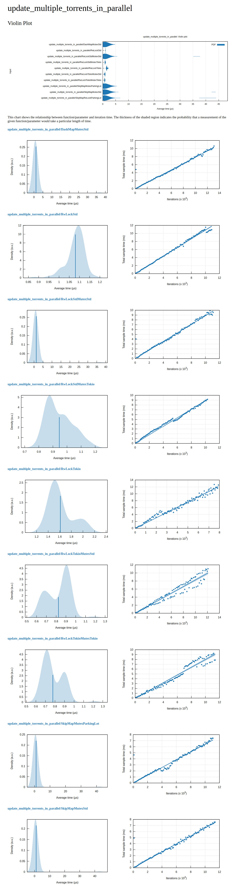

---
semantic-links:
  skill-links:
    - write-markdown-docs
    - run-benchmarks
  related-artifacts:
    - docs/index.md
    - docs/profiling.md
    - docs/testing.md
    - docs/issues/closed/1505-optimize-peer-ip-list-from-swarm/aquatic-benchmarking-guide.md
    - docs/issues/closed/2458-inject-udp-cookie-cipher/performance-evidence.md
    - packages/udp-core/benches/
    - packages/udp-server/benches/
    - packages/http-core/benches/
    - packages/torrent-repository-benchmarking/
    - packages/persistence-benchmark/
    - packages/swarm-coordination-registry/examples/bench_peers.rs
    - contrib/dev-tools/benches/run-benches.sh
    - contrib/dev-tools/workflow-benchmarks/
    - share/default/config/tracker.udp.benchmarking.toml
---

# Benchmarking

Benchmarks measure performance under a defined workload. They complement the correctness tests
described in [Testing Strategy](testing.md); use [profiling](profiling.md) to find where a workload
spends its time. The [`run-benchmarks` skill](../.github/skills/dev/benchmarking/run-benchmarks/SKILL.md)
is the agent workflow for this guide.

## Benchmark Levels and Tools

| Level                         | Tool and location                                                                                                                                                                    | Measures                                                                                                 | Does not measure              | Run it with                                                                                                 |
| ----------------------------- | ------------------------------------------------------------------------------------------------------------------------------------------------------------------------------------ | -------------------------------------------------------------------------------------------------------- | ----------------------------- | ----------------------------------------------------------------------------------------------------------- |
| Function microbenchmark       | Criterion, `packages/udp-core/benches/connection_cookie_benchmark.rs`                                                                                                                | One `connection_cookie::make` or `check` call                                                            | Request handling, I/O         | `cargo bench -p torrust-tracker-udp-core --bench connection_cookie_benchmark`                               |
| Service microbenchmark        | Criterion, `packages/udp-core/benches/udp_tracker_core_benchmark.rs`                                                                                                                 | One awaited `ConnectService::handle_connect`, events disabled                                            | Socket I/O, events            | `cargo bench -p torrust-tracker-udp-core --bench udp_tracker_core_benchmark`                                |
| Service microbenchmark        | Criterion, `packages/udp-core/benches/ban_service_benchmark.rs` ([guide](../packages/udp-core/docs/benchmarking/banning.md))                                                         | `BanService` counter operations                                                                          | Socket I/O, lock contention   | `cargo bench -p torrust-tracker-udp-core --bench ban_service_benchmark`                                     |
| Handler microbenchmark        | Criterion, `packages/udp-server/benches/udp_tracker_server_benchmark.rs`                                                                                                             | One `handle_scrape` of 74 torrents                                                                       | Socket I/O, the receive loop  | `cargo bench -p torrust-tracker-udp-server`                                                                 |
| Service microbenchmark        | Criterion, `packages/http-core/benches/http_tracker_core_benchmark.rs`                                                                                                               | One awaited `AnnounceService::handle_announce`, a repeat announce ([why](#http-announce-microbenchmark)) | HTTP parsing, first announces | `cargo bench -p torrust-tracker-http-core`                                                                  |
| Service microbenchmark        | Criterion, `packages/http-core/benches/http_tracker_core_benchmark.rs`                                                                                                               | A new peer's `handle_announce`, swarms of 0/74/1000 ([why](#http-first-announce-microbenchmark))         | HTTP parsing, repeat announces| `cargo bench -p torrust-tracker-http-core`                                                                  |
| Data-structure microbenchmark | Criterion, `packages/torrent-repository-benchmarking/`                                                                                                                               | Torrent repository implementations                                                                       | The tracker's other layers    | `cargo bench -p torrust-tracker-torrent-repository-benchmarking`                                            |
| Example-based microbenchmark  | `packages/swarm-coordination-registry/examples/bench_peers.rs`                                                                                                                       | `Coordinator::peers_excluding`                                                                           | Serialization, I/O            | `cargo run -p torrust-tracker-swarm-coordination-registry --example bench_peers --release`                  |
| Persistence benchmark         | `packages/persistence-benchmark/` ([README](../packages/persistence-benchmark/README.md)); reports in `packages/tracker-core/docs/benchmarking/`; CI workflow `db-benchmarking.yaml` | Database driver operations                                                                               | In-memory tracker paths       | `cargo run -p torrust-tracker-persistence-benchmark --bin persistence_benchmark_runner -- --driver sqlite3` |
| End-to-end load test          | `aquatic_udp_load_test` against a release build ([E2E UDP load testing](#e2e-udp-load-testing))                                                                                      | UDP responses per second through the real socket                                                         | Which function costs what     | See the section below                                                                                       |
| Comparative benchmark         | `aquatic_bencher` ([section](#comparative-udp-benchmarking-with-aquatic_bencher))                                                                                                    | Throughput against other trackers                                                                        | Small regressions             | See the section below                                                                                       |
| Workflow timing               | `contrib/dev-tools/workflow-benchmarks/`                                                                                                                                             | CI-equivalent step durations                                                                             | Tracker performance           | The scripts' usage comments                                                                                 |

`contrib/dev-tools/benches/run-benches.sh` runs the Criterion benchmarks of several packages in one
go for local exploration.

## Choosing a Benchmark

Pick the lowest level that measures the code you change, and add an end-to-end measurement when
users would notice the change:

- **A function or service on the request path** (for example connection IDs, announce, or scrape
  handling): a Criterion microbenchmark of that code, plus the end-to-end UDP load test for
  user-visible throughput. If no microbenchmark covers the code, add one in its own commit before
  changing production code, so the baseline can use it.
- **The in-memory torrent repository or swarm code:** the repository benchmarks or `bench_peers`.
- **The persistence layer or a database driver:** the persistence benchmark.
- **CI or workflow duration:** the workflow timing scripts.
- **Comparing with other trackers:** `aquatic_bencher`. It is not precise enough to detect
  regressions.
- **Finding out why something is slow:** [profiling](profiling.md), not a benchmark.

A microbenchmark is precise but says nothing about the whole request; the load test is
user-visible but noisy (expect about ±5–10% between runs on a desktop). Use both when a change
touches the hot path.

## Recording Before-and-After Evidence

When an issue changes performance-critical code, measure it before and after:

1. **Plan it in the issue specification:** the instruments, the measurements, and a one-sided pass
   rule, for example "the after mean is not below the lowest baseline run" and "each after
   Criterion median is not above the highest baseline median". A two-sided band fails on an
   improvement. When the change deliberately adds work to a measured path, for example maintaining
   a counter on every event, the one-sided rule cannot pass for that benchmark as written: state
   the expected cost or an explicit tolerance for it in the plan, agreed with the maintainer before
   the after measurement. In issue #2505 the plan had neither, so the after measurement failed the
   rule and the cost was accepted only afterwards.
2. **Record the baseline before any production change**, on the code the branch starts from plus
   only documentation and benchmark-only commits.
3. **Repeat the measurement after the change** on the same machine, with the same build profile,
   configuration, and load-test settings. Change benchmark code only as far as new signatures
   require: even code outside the timed loop can move a nanosecond-scale result. In issue #2479,
   a control build of `connect_once` that added the routine guard's code only outside the timed
   loop, leaving the loop byte-identical, moved from about 58 ns to about 65 ns, a code-layout
   effect. The committed guard, which does add `track` to the timed loop, measures the same
   about 65 ns.
4. **Run each instrument several times:** for example three Criterion runs, reading each benchmark's
   median from `target/criterion/<group>/<function>/new/estimates.json` (the group's `/` becomes
   `_`, and each run overwrites the file), and five 30-second load-test runs, each with a fresh
   tracker. Run commands that parse or format numbers, such as `awk`, `printf`, and `sort`, with
   `LC_ALL=C`: under a locale with a decimal comma they print `9,000` for 9.0 or truncate
   decimals. In issue #2505 that briefly made Criterion medians look quantized.
5. **Check the machine first.** On a shared desktop, run `uptime` and look for other builds; wait
   until the load is close to the baseline's before measuring. Also check that no other tracker is
   running and that the ports the benchmarking configuration uses are free: UDP `3000`, and TCP
   `127.0.0.1:1313` for the health check API, which the configuration does not set and which
   starts on that default address. `ss -lun 'sport = :3000'` and `ss -ltn 'sport = :1313'` should
   list no socket. In issue #2505, a tracker left running for a manual recheck held port 1313, so
   the benchmark tracker exited at startup and the load test measured 0 responses per second.
6. **Record everything in issue-local `performance-evidence.md`:** machine, toolchain, commands,
   configuration, every run, the observed noise, and times taken from output files or `git log`,
   not from memory.

Worked examples: issue #2458
([`performance-evidence.md`](issues/closed/2458-inject-udp-cookie-cipher/performance-evidence.md)),
issue #2342, and issue #2314.

## Checking That a Benchmark Measures Something

A benchmark can pass while measuring nothing. Before trusting one, compare its result with a cost
you know: for example, one Blowfish block encryption takes tens of nanoseconds, so a connect
benchmark reporting 3.5 ns cannot be encrypting.

The common cause is an `async fn` passed to Criterion's `b.iter`: the closure returns a future that
is never polled, so only the creation of the future is timed. Build the service once, outside the
measured closure, and await it on a runtime:

```rust
let runtime = tokio::runtime::Runtime::new().expect("it should build a Tokio runtime");
group.bench_function("connect_once", |b| {
    b.to_async(&runtime).iter(|| context.connect_once());
});
```

### Routine Guard for Async Benchmarks

Comparing with a known cost is a manual check. The async Criterion benchmarks, `udp-core`
`connect_once` and `http-core` `announce_once` and `first_announce`, also carry a guard that fails
them when the measured routine never runs. Each package keeps a copy of it in
`benches/helpers/routine_guard.rs`:

```rust
let guard = RoutineGuard::default();

{
    let mut group = c.benchmark_group(GROUP);
    group.bench_function(BENCHMARK, |b| {
        guard.record_benchmark_invocation();
        b.to_async(&runtime).iter(|| guard.track(context.connect_once()));
    });
    group.finish();
}

guard.assert_routine_ran(&format!("{GROUP}/{BENCHMARK}"));
```

- `track` counts each routine that runs to completion. `assert_routine_ran` panics, naming the
  benchmark, when Criterion invoked the closure but no routine completed.
- Criterion runs every benchmark once under `cargo test --benches`, which the pre-push hook and CI
  run, so a routine passed to `b.iter` instead of being awaited fails those gates.
- Criterion never invokes the closure of a benchmark it skips (a `cargo bench -- <filter>` that
  does not match it, or `--list`), so a skipped benchmark passes. For the same reason the closure
  must call `record_benchmark_invocation`: without it the guard cannot fail.
- `track` uses a poll-level combinator, `futures::FutureExt::inspect`, whose cost is not
  measurable on `connect_once`. An `async fn` wrapper added 10-15 ns to that 60 ns benchmark.

Add the guard to every new async Criterion benchmark.

> For a detailed step-by-step guide with full command output and troubleshooting, see the
> [Aquatic Benchmarking Guide](issues/closed/1505-optimize-peer-ip-list-from-swarm/aquatic-benchmarking-guide.md)
> (created during issue #1505).

## Prerequisites

- Linux 6.0+ (for `io_uring` support)
- Rust toolchain
- System packages for `aquatic_bencher`: `cmake`, `build-essential`, `pkg-config`, `git`, `screen`, `cvs`, `zlib1g-dev`, `golang`
- For `io_uring` feature: `libhwloc-dev`

## E2E UDP load testing

### 1. Build the Torrust tracker

```console
cargo build --release
```

### 2. Start the tracker with benchmarking config

The project provides a benchmarking configuration at `share/default/config/tracker.udp.benchmarking.toml`
that disables logging, tracking usage stats, persistent metrics, and peerless torrent removal.
It binds the UDP tracker to `0.0.0.0:3000`:

```toml
[logging]
trace_filter = "error"
trace_style = "full"

[[udp_trackers]]
bind_address = "0.0.0.0:3000"
```

Start the tracker:

```console
./target/release/torrust-tracker \
  --config-toml-path ./share/default/config/tracker.udp.benchmarking.toml
```

### 3. Build the aquatic UDP load test

```console
git clone git@github.com:greatest-ape/aquatic.git
cd aquatic
cargo build --release -p aquatic_udp_load_test
```

> **Note**: Prefer building from source over `cargo install` to ensure the tool can be rebuilt
> later if dependencies change.

### 4. Generate the load test config

```console
./target/release/aquatic_udp_load_test -p > load-test-config.toml
```

Edit `load-test-config.toml` to adjust parameters like `announce_peers_wanted` (number of
peers requested per announce), `duration` (run time in seconds), or `summarize_last`
(window for the summary report). The default config already points to `127.0.0.1:3000`
matching the benchmarking config — no port change needed.

Example config for 10-second run with 74 peers wanted:

```toml
server_address = "127.0.0.1:3000"
log_level = "error"
workers = 1
duration = 10
summarize_last = 5
extra_statistics = true

[network]
multiple_client_ipv4s = true
sockets_per_worker = 4
recv_buffer = 8000000

[requests]
number_of_torrents = 1000000
number_of_peers = 2000000
scrape_max_torrents = 10
announce_peers_wanted = 74
weight_connect = 50
weight_announce = 50
weight_scrape = 1
peer_seeder_probability = 0.75
```

### 5. Run the load test

```console
cd /path/to/aquatic
./target/release/aquatic_udp_load_test -c load-test-config.toml
```

Example output:

```text
Requests out: 172510.83/second
Responses in: 172383.48/second
  - Connect responses:  85442.62
  - Announce responses: 85242.81
  - Scrape responses:   1698.05
  - Error responses:    0.00
Peers per announce response: 47.58

# aquatic load test report
Test ran for 10 seconds (only last 5 included in summary)
Average responses per second: 171718.89
  - Connect responses:  85084.98
  - Announce responses: 84945.36
  - Scrape responses:   1688.55
  - Error responses:    0.00
```

> **Important**: The performance of the Torrust UDP tracker is **drastically decreased**
> with verbose logging. Always use `trace_filter = "error"` for benchmarking.

```text
# With log threshold "info":
Requests out: 40719.21/second
Responses in: 33762.72/second
```

### Troubleshooting

#### Cookie errors during load test

```text
ERROR UDP TRACKER: response error error=tracker announce error:
  Connection cookie error: cookie value is expired: ...
```

This is **normal**. The load test sends a burst of requests at the start, and some
arrive before the tracker's cookie system expects them. These errors account for
a tiny fraction of requests (typically `< 0.001%` of error responses) and do not
affect the overall throughput measurement.

#### Result variance

Benchmark results vary between runs due to system load, CPU frequency scaling,
and background processes. Typical variance for the UDP load test is **±5–10%**
on a non-dedicated machine. For before/after comparison, run multiple iterations
and use the median.

## Comparative UDP benchmarking with `aquatic_bencher`

The Aquatic repository's `aquatic_bencher` can compare multiple trackers
(`aquatic_udp`, `opentracker`, `chihaya`, `torrust-tracker`) on the same machine.

### 1. Build the bencher

```console
cd /path/to/aquatic
cargo build --profile release-debug -p aquatic_bencher
```

> **Note**: This uses `release-debug` profile (not `--release`) — the bencher needs
> debug symbols for CPU utilization measurements.

### 2. Install other trackers

Each tracker must be built and available in `PATH` or specified via CLI args:

- **Opentracker**: Build from source at https://erdgeist.org/arts/software/opentracker/
- **Chihaya**: Install with `go install` from https://github.com/chihaya/chihaya
- **Aquatic UDP**: `cargo build --profile release-debug -p aquatic_udp` (in the aquatic repo)

### 3. Run the bencher

```console
cd /path/to/aquatic
./target/release-debug/aquatic_bencher \
  --min-priority medium --cpu-mode subsequent-one-per-pair
```

The bencher supports the `--torrust-tracker` argument to specify the path to the
torrust-tracker binary (default: looks for `torrust-tracker` in `PATH`).

### Previous results (2024)

Using a PC with:

- RAM: 64 GiB
- Processor: AMD Ryzen 9 7950X x 32
- OS: Ubuntu 23.04
- Kernel: Linux 6.2.0-20-generic

| Tracker                 | Announce req/s (1 core, 8 workers) |
| ----------------------- | ---------------------------------- |
| Aquatic (io_uring)      | 389,576                            |
| Aquatic                 | 351,834                            |
| Opentracker (workers 1) | 343,570                            |
| Opentracker (workers 0) | 297,698                            |
| **Torrust**             | **222,330**                        |
| Chihaya                 | 115,159                            |

See the [latest official results](https://github.com/greatest-ape/aquatic/blob/master/documents/aquatic-udp-load-test-2024-02-10.md)
for more data.

## Microbenchmarks

### Repository benchmarking

Tests the different implementations for the internal torrent storage.

```console
cargo bench -p torrust-tracker-torrent-repository-benchmarking
```

Example output:

```output
     Running benches/repository_benchmark.rs (target/release/deps/repository_benchmark-2f7830898bbdfba4)
add_one_torrent/RwLockStd
                        time:   [60.936 ns 61.383 ns 61.764 ns]
add_one_torrent/RwLockStdMutexStd
                        time:   [60.829 ns 60.937 ns 61.053 ns]
add_one_torrent/RwLockStdMutexTokio
                        time:   [96.034 ns 96.243 ns 96.545 ns]
add_one_torrent/RwLockTokio
                        time:   [108.25 ns 108.66 ns 109.06 ns]
```

After running, HTML reports are generated in `target/criterion/`:

```console
target/criterion/
├── add_multiple_torrents_in_parallel
├── add_one_torrent
├── report
├── update_multiple_torrents_in_parallel
└── update_one_torrent_in_parallel
```

### Peer retrieval microbenchmark

Measures the `Coordinator::peers_excluding` path directly — the core operation that
extracts peer lists from a swarm for announce responses.

```console
cargo run --package torrust-tracker-swarm-coordination-registry \
  --example bench_peers --release
```

Example output:

```text
=== Baseline: Coordinator::peers_excluding ===
iterations=100000
  10 peers:      96.85 ns/iter  (9.68 ns/peer)
  74 peers:     402.05 ns/iter  (5.43 ns/peer)
 100 peers:     439.80 ns/iter  (4.40 ns/peer)
 500 peers:     404.60 ns/iter  (0.81 ns/peer)
1000 peers:     419.53 ns/iter  (0.42 ns/peer)
```

Source: `packages/swarm-coordination-registry/examples/bench_peers.rs`.

### HTTP announce microbenchmark

Measures one awaited `AnnounceService::handle_announce` on an in-memory public tracker with usage
statistics enabled: the authentication and whitelist checks, client IP resolution, the swarm
update, and sending one HTTP statistics event. It does not include HTTP parsing or the Axum
server.

```console
cargo bench -p torrust-tracker-http-core --bench http_tracker_core_benchmark
```

Example output (AMD Ryzen 9 7950X, issue #2479):

```output
http_tracker/announce_once/announce_once
                        time:   [337.91 ns 341.80 ns 346.61 ns]
```

Every iteration announces the same peer to the same torrent. After the first iteration, it
therefore times a repeat announce: the update of the only peer in a one-peer swarm, with an empty
peer list in the response. This is deliberate:

- **Comparable results.** Every iteration does the same work, so a difference between two runs
  comes from the code under test.
- **A new peer per iteration would not be stable.** Criterion runs millions of iterations without
  any cleanup, so the swarm would grow by one peer per iteration and the cost would drift with its
  size (inserts into a larger map, memory pressure). The result would depend on how many iterations
  Criterion chose in that run.
- **It is the common production case.** Clients re-announce periodically, so most announces update
  an existing peer.

The result is a lower bound on announce cost: it does not include inserting a new peer or building
a non-empty peer list. The [first-announce benchmark](#http-first-announce-microbenchmark)
measures those two.

### HTTP first-announce microbenchmark

Measures one awaited `AnnounceService::handle_announce` with event `started` for a peer that is not
in the swarm, for swarms of 0, 74, and 1000 other seeders. It includes what the repeat-announce
benchmark includes, plus inserting the peer, the swarm "peer added" event, and a peer list built
from the other peers: up to 74, the default `max_peers_per_announce`. Unlike the repeat-announce
benchmark, the swarm registry sends its events to the swarm statistics listener, wired as in
production. It does not include HTTP parsing or the Axum server.

```console
cargo bench -p torrust-tracker-http-core --bench http_tracker_core_benchmark -- first_announce
```

Example output (shared Linux desktop with a load average of 4-8, issue #2518; the medians of
three runs varied by 7-9%):

```output
http_tracker/first_announce/0
                        time:   [431.73 ns 432.20 ns 432.66 ns]
http_tracker/first_announce/74
                        time:   [1.1534 µs 1.1643 µs 1.1740 µs]
http_tracker/first_announce/1000
                        time:   [1.1542 µs 1.1650 µs 1.1756 µs]
```

- **0 peers** is the insert with an empty peer list.
- **74 peers** returns a full default peer list.
- **1000 peers** also returns 74 peers, from a larger map, so a result equal to the 74-peer one
  shows that swarm size alone does not change the cost.

To keep the swarm at exactly the same size however many iterations Criterion runs, each iteration
times only the `started` announce (Criterion's `iter_custom`), and the peer then leaves with a
`stopped` announce that is not timed. The result has these limits:

- **It includes two clock reads per iteration,** tens of nanoseconds, a constant in every run, plus
  the `RoutineGuard`'s counter increment. Compare first-announce results only with each other,
  never with `announce_once`, whose iterations are timed in bulk.
- **Part of the removal can leak in.** The statistics events of the `stopped` announce may still be
  processed by the listener during the next timed announce.
- **It is not a join-and-leave cycle.** Timing both announces would add an insert and a removal
  into one number, so a change to either could not be attributed.

The discarded designs, with their reasons, are in decision D1 of
[the issue specification](issues/closed/2518-http-first-announce-benchmark/ISSUE.md): Criterion's
`iter_batched` cannot await an asynchronous removal in its synchronous setup, a new peer on every
iteration makes the swarm grow, and a rotating pool of peers would measure repeat announces after
its first pass.

The benchmark also fails under `cargo test --benches` when it stops measuring first announces: it
asserts that the swarm still has exactly its pre-filled peers after the run, that the swarm
statistics counted only inserts and removals and no updates, and that the first announce returned
`min(N, 74)` peers. The exact counts apply while the run sends no more swarm events than the event
bus holds (65,536); after a longer run, such as `cargo bench`, only checks that dropped events
cannot break are applied.

## Notes

- **Port convention**: The benchmarking config (`tracker.udp.benchmarking.toml`) binds to
  port **3000**, which matches the `aquatic_udp_load_test` default. No port change needed.
- **Log level**: Always use `trace_filter = "error"` for benchmarking. Verbose logging
  (`info`, `debug`, `trace`) reduces throughput by ~10×.
- **Workers**: The default UDP load test uses 1 worker. Increase for higher load:
  increase both `workers` in the config and add more CPU cores to the tracker.
- **Multiple `announce_peers_wanted` values**: Adding 74 peers (BEP 23 max) vs 10 peers
  typically does **not** significantly change UDP throughput — the bottleneck is at the
  connection/socket layer, not peer-list serialization.
- **Result variance**: Expect ±5–10% variance between runs on a non-dedicated machine.
  Run multiple iterations and use the median.

You can see one report for each of the operations we are considering for benchmarking:

- Add multiple torrents in parallel.
- Add one torrent.
- Update multiple torrents in parallel.
- Update one torrent in parallel.

Each report look like the following:



## Other considerations

If you are interested in knowing more about the tracker performance or contribute to improve its performance you ca join the [performance optimizations discussion](https://github.com/torrust/torrust-tracker/discussions/774).
