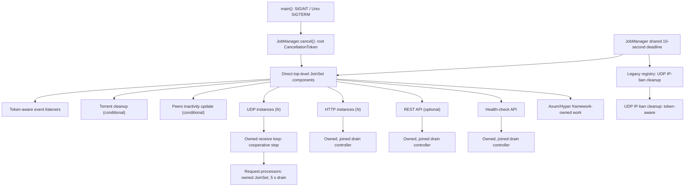

# Task Inventory

## Purpose and Scope

This is the implementation-time task-ownership evidence for the production
tracker, revalidated for [issue #1588][issue-1588] after [issue #1586][issue-1586]
adopted direct `JoinSet` supervision. It follows the normal `app::start()`
startup path and excludes tests, benchmarks, the tracker-client application,
and third-party framework internals whose exact task topology is not exposed.

`main()` is the executable signal boundary: it accepts `SIGINT` and, on Unix,
`SIGTERM`; it then calls `JobManager::cancel()` and awaits all manager-owned
work under one shared ten-second deadline. The supervisor owns direct
top-level component futures only. Components own nested tasks and must join or
deliberately abort them before returning; `JobManager` never collects nested
handles.

## Conceptual Ownership Tree

Tokio tasks have no process IDs. This conceptual tree represents task creation
and supervision ownership, not operating-system parent-child relationships.
`N` means one task per matching configured item.

```text
torrust-tracker process (Tokio runtime; main)
└─ app::start() / start_jobs()
   └─ JobManager
      ├─ Direct JoinSet components
      │  ├─ seven token-aware event-listener categories [conditional as listed below]
      │  ├─ torrent cleanup [conditional]
      │  ├─ peers inactivity update [conditional]
      │  ├─ UDP instance [N configured public bindings; component child token]
      │  │  └─ receive loop [component-owned OwnedTask; stops cooperatively on cancellation]
      │  │     └─ request processors [N datagrams; loop-owned JoinSet; 5 s drain; AbortHandle eviction ring]
      │  ├─ HTTP instance [N configured bindings; component child token]
      │  │  ├─ server task [component-owned TokenAwareServerTask]
      │  │  └─ drain controller [component-owned and joined]
      │  ├─ REST API [conditional; component child token]
      │  │  ├─ server task [component-owned TokenAwareServerTask]
      │  │  └─ drain controller [component-owned and joined]
      │  └─ health-check API [always; component child token]
      │     ├─ server task [component-owned TokenAwareServerTask]
      │     └─ drain controller [component-owned and joined]
      ├─ Legacy registry (pre-spawned periodic jobs, not JoinSet members)
      │  └─ UDP IP-ban cleanup [conditional; CancellationToken]
      └─ Axum/Hyper connection and request work [framework-owned]
```



## Current Inventory

The table is a compact overview. The [detailed inventory](#detailed-inventory)
below records the exact ownership, cancellation, and completion evidence for
each row.

| Work                          | Cardinality | Ownership        | Current shutdown         | Roadmap                |
| ----------------------------- | ----------- | ---------------- | ------------------------ | ---------------------- |
| Swarm-registry listener       | 0–1         | Direct `JoinSet` | Root token               | —                      |
| Tracker-core listeners        | 0–2         | Direct `JoinSet` | Root token               | —                      |
| HTTP-core listener            | 1           | Direct `JoinSet` | Root token               | —                      |
| UDP-core listener             | 1           | Direct `JoinSet` | Root token               | —                      |
| UDP-server listeners          | 0–2         | Direct `JoinSet` | Root token               | —                      |
| UDP instances                 | N bindings  | Direct `JoinSet` | Child token              | SI-14 complete         |
| UDP request processors        | N datagrams | Component-owned  | Joined, 5 s drain        | SI-15 complete         |
| HTTP instances                | N bindings  | Direct `JoinSet` | Child token              | SI-11 complete         |
| REST API                      | 0–1         | Direct `JoinSet` | Child token              | SI-12 complete         |
| Health-check API              | 1           | Direct `JoinSet` | Child token              | SI-13 complete, SI-21  |
| HTTP/REST drain controllers   | Per server  | Component-owned  | Child token, 90 s drain  | SI-11, SI-12 complete  |
| Health-check drain controller | 1           | Component-owned  | Child token, 5 s drain   | SI-13 complete         |
| Health-check request work     | Per request | Framework-owned  | Request lifetime         | —                      |
| Torrent cleanup               | 0–1         | Direct `JoinSet` | Root token               | SI-4 complete          |
| Peers inactivity update       | 0–1         | Direct `JoinSet` | Root token               | SI-5 complete          |
| UDP IP-ban cleanup            | 0–1         | Legacy registry  | Root token               | Periodic-job migration |

## Detailed Inventory

### Direct `JoinSet` Components

- **Torrent cleanup** — starts when `inactive_peer_cleanup_interval > 0`. Its
  unspawned runner observes the root token or weak-manager expiry and reports
  cooperative cancellation or normal completion to `JobManager`.
- **Peers inactivity update** — starts when `tracker_usage_statistics` is
  enabled. Its unspawned runner observes the root token or weak registry or
  statistics-repository expiry and reports cooperative cancellation or normal
  completion to `JobManager`.
- **Swarm-registry statistics listener** — starts only when
  `tracker_usage_statistics` is enabled. Its unspawned runner receives the
  root token and reports either cooperative cancellation or completion.
- **Tracker-core listeners** — the in-memory listener starts with
  `tracker_usage_statistics`; the persistent completed-statistics listener
  starts when persistent completed statistics are enabled and fails startup if
  persistence is absent. Both are token-aware direct components.
- **HTTP-core and UDP-core listeners** — each starts exactly once, even when
  the corresponding server bindings are absent. Both are token-aware direct
  components.
- **UDP-server statistics and banning listeners** — each starts when UDP
  services are enabled: the tracker is public and the UDP configuration is
  non-empty. Both are token-aware direct components.
- **UDP instances** — one direct component per enabled UDP binding, each with
  a child of the `JobManager` root token. The component owns the receive loop
  through `OwnedTask`, created before the component future is returned, and
  aborts it if dropped. The loop observes the token between datagrams, drains
  its request processors, and returns `Ok(())`, so the component reports
  cooperative cancellation; a receive error or panic fails the component
  (SI-14, SI-15).
- **HTTP instances and REST API** — direct components with a child token each.
  They own their server task and token-aware drain controller through
  `TokenAwareServerTask` and join both after cancellation or independent
  server completion. There is one HTTP component per configured binding and
  zero or one REST component when `http_api` is configured (SI-11, SI-12).
- **Health-check API** — an always-present direct component that receives a
  child of the `JobManager` root token. It owns both the server and its
  token-aware drain controller through `TokenAwareServerTask`; it joins both
  after cancellation or independent server completion and aborts them if
  dropped. The drain has a 5-second budget (SI-13).

### Component-Owned, Detached, and Framework-Owned Work

- **UDP request processors** — the receive loop spawns one per datagram into a
  loop-owned `JoinSet`, reaping finished processors before each spawn. A
  bounded `AbortHandle` ring still decides overload eviction but no longer
  owns the tasks. On cancellation the loop stops admitting datagrams, waits up
  to five seconds, aborts and joins the rest, and logs one summary with
  `completed`, `failed`, `aborted`, and `evicted` counts. A receive error
  aborts and joins every processor before returning. The socket `Arc` clones
  held by processors are therefore released before the loop returns (issue
  #2370). In the summary, the drain-start `active` count includes finished
  processors not yet reaped, and `evicted` counts only overload evictions not
  yet reaped at shutdown; `aborting request` warnings report all evictions.
  The package-local
  [request-concurrency ADR](../../../packages/udp-server/docs/adrs/20260929181216_bound_udp_request_concurrency_with_task_per_request_ring.md)
  records the admission, eviction, and ownership design.
- **HTTP and REST drain controllers** — each token-aware server spawns a
  controller that waits for its component token, then drains for up to 90
  seconds. The component joins it before reporting its outcome; the 90-second
  budget still exceeds the manager's shared ten-second deadline (SI-20).
- **Health-check request work** — request-scoped aggregation awaits with
  `join_all`; protocol probes are spawned inside service checks. Axum/Hyper
  own connection and request topology, so none of this work is manager-owned.

### Legacy Registry

- **UDP IP-ban cleanup** — starts with UDP services. Its pre-spawned legacy
  handle observes the root token; the manager waits for it or aborts and joins
  it at the deadline.

The direct-component count is configuration dependent:

$$
3 + I_{cleanup} + 2I_{usage} + I_{persistent} + I_{udp}(2 + N_{udp}) + N_{http} + I_{api}
$$

The constant three represents the HTTP-core listener, UDP-core listener, and
health-check API. Torrent cleanup is conditional on its cleanup interval. The
sole legacy job is separately conditional as shown above.

## Event Producer-Consumer Inventory

This section lists who publishes on and who consumes from each event bus, and
which component owns the channel. The bus topology, the HTTP and UDP asymmetry,
and the proposed normalization stay in [`events.md`][events-architecture];
this section does not repeat them. Everything below was read from source on
2026-10-16 at `develop` commit `702cff6cc` and was not run.

[`events.md`][events-architecture] documents three buses (HTTP core, UDP core,
UDP server). It omits the swarm bus, which carries the swarm-coordination
registry events consumed by three listeners. Reconciling the two documents is
left to the sub-EPIC's later documentation task.

### Channel ownership

Every bus is an `EventBus` whose `Broadcaster` wraps one `tokio` broadcast
channel with a capacity of 65,536 events (`packages/events/src/broadcaster.rs`).
Each bus lives in a package container, and `AppContainer` owns those
containers. `main` binds the container as `_app_container` and holds it past
`jobs.wait_for_all(...)` (`src/main.rs`), so the channels stay open through
listener shutdown. `EventBus::sender()` clones the `Broadcaster`, so each
producer holds its own sender; `EventBus::receiver()` calls `subscribe()`.
`broadcast::Receiver<Event>` is the only production `Receiver` implementation
(`packages/events/src/broadcaster.rs`).

### Buses, producers, and consumers

| Bus | Producers (publish sites) | Consumers (listeners) |
| --- | --- | --- |
| Swarm (swarm-coordination registry) | `swarm/coordinator.rs` (`PeerAdded`, `PeerRemoved`, `PeerUpdated`, `PeerDownloadCompleted`) and `swarm/registry.rs` (`TorrentAdded`, `TorrentRemoved`), driven by announce requests through the HTTP and UDP request paths and by the torrent cleanup job | `swarm_coordination_registry_event_listener`; `tracker_core_in_memory_event_listener`; `tracker_core_persistent_completed_statistics_event_listener` (only when persistent completed-download statistics are enabled) |
| HTTP core | `http-core` `services/announce.rs` and `services/scrape.rs` | `http_core_event_listener` |
| UDP core | `udp-core` `services/connect.rs`, `services/announce.rs`, `services/scrape.rs` | `udp_core_event_listener` |
| UDP server | `udp-server` `server/processor.rs` (`UdpRequestDiscarded`, `UdpResponseSent`) and `handlers/{connect,announce,scrape,error}.rs` (including `UdpError`) | `udp_server_stats_event_listener`; `udp_server_banning_event_listener` (both started only with the UDP tracker services) |

The listeners subscribe synchronously during bootstrap
(`src/bootstrap/jobs/{torrent_repository,tracker_core,http_tracker_core,udp_tracker_core,udp_tracker_server}.rs`,
through `EventBus::receiver()`), before the runner future is spawned.
`start_jobs_with_manager` starts the five core listeners first, then the UDP
services, the HTTP instances, torrent cleanup, the inactivity update, the REST
API, and the health-check API (`src/app.rs`). A request can only arrive after
the listener of its bus has subscribed.

### Components that publish nothing

- `peers_inactivity_update` (activity metrics) reads the swarm registry and
  writes metrics; it sends no event.
- `udp_ban_cleanup` calls `reset_bans`, which updates the ban service and the
  statistics repository directly; it sends no event.
- The REST API handlers (stats, torrents, auth keys, whitelist) do not mutate
  swarms, so the REST API publishes no swarm event. Its test environment seeds
  a swarm through the in-memory torrent repository's `handle_announcement`
  (test setup only).
- The health-check API sends no event.

Torrent cleanup publishes indirectly: `TorrentsManager::cleanup_torrents` calls
`remove_inactive_peers` and `remove_peerless_torrents`, which send `PeerRemoved`
and `TorrentRemoved` on the swarm bus.

### Producer send path

All publish sites call `.send(...).await` inline in the request path or in the
service that handles it; none sends from a detached task.
`Broadcaster::send` wraps the synchronous `broadcast::Sender::send`, so the
await completes immediately. The UDP processors that publish
`UdpRequestDiscarded` and `UdpResponseSent` run in the launcher's processor set,
which the receive loop joins on cancellation (SI-15). The `spawn` hits
found in event modules are test code or the listener spawns themselves.

### Test environments

| Environment | Listeners | Subscription and ownership |
| --- | --- | --- |
| HTTP tracker (`packages/axum-http-server/src/testing/environment.rs`) | One: the HTTP-core statistics listener | Subscribes before the server starts; spawns the listener after a successful start; the `Running` state holds a `DropGuard` (`cancel_on_drop`) on its own token. |
| UDP tracker (`packages/udp-server/src/testing/environment.rs`) | Three: UDP-core statistics, UDP-server statistics, and UDP-server banning | Subscribes all three receivers before the server starts; the `Running` state holds a `DropGuard` (`cancel_on_drop`) on its own token. |
| REST API and health-check API | None | These environments run no event listener. |

Neither tracker environment runs a swarm-bus listener, although announce
requests can publish on that bus; no listener consumes those events there.

### Recheck of record entry 27 (read from source, not run)

| Fact in entry 27 | Result |
| --- | --- |
| `main` holds `_app_container` until after `wait_for_all` | Confirmed (`src/main.rs`). |
| Consumers subscribe in bootstrap before producers start | Confirmed (see above). |
| Sends are `.send(...).await` in the request path, none detached | Confirmed; no detached sender found. |
| `udp_ban_cleanup` has no events | Confirmed. |
| Torrent cleanup and the REST API publish no event of their own | Differs: cleanup publishes on the swarm bus indirectly (above); the REST API does not mutate swarms. |

Counts rechecked on 2026-10-16: `src/app.rs` has 13 `job_manager.spawn` sites
(a plain `spawn` search reports 14 lines because the extra match is in a
test at line 654), 14 token sites and 4 `child_token`
calls. There is one production `Receiver` implementation plus six test
`ScriptedReceiver` implementations, seven in total. Seven
`it_should_prioritize_*` tests exist across the six listener files.

## Findings and Roadmap Mapping

1. The #1586 supervisor boundary is present: direct top-level component
  futures enter `JoinSet`; component child handles do not. The pre-spawned UDP
  IP-ban cleanup job remains the sole deliberately narrow compatibility
  registry entry under the same process-wide deadline.
2. `main.rs` now handles Unix `SIGTERM` at the executable boundary. SI-1 is
   complete, so this is not an open gap.
3. `peers_inactivity_update` is a direct token-aware component after SI-5. It
  observes `jobs.cancel()` and reports cooperative cancellation; torrent
  cleanup is a direct token-aware component after SI-4.
4. The production tracker no longer uses private `Halted` channels or
   library-level OS signals for any server component. The HTTP and UDP test
   environments and examples use the token-aware path after SI-16 (#2412)
   and SI-17 (#2448). The legacy `Halted` APIs remain for the REST API and
   health-check API test environments (SI-23, SI-24) and other legacy callers
   until deprecation and removal in SI-18 and SI-19.
   The legacy UDP launcher is now an adapter over
   the token-aware receive loop, so it can no longer panic or detach it.
5. HTTP, REST, and health-check drain controllers are component-owned and
   joined. Aligning their drain budgets with the manager deadline is SI-20.
6. Health-check lifecycle uses the token-aware path after SI-13 but does not
   yet mark readiness unhealthy before draining: SI-21.
7. UDP stops its receive loop cooperatively after SI-14 and, after SI-15, joins
   every request processor under a five-second drain and reports their
   outcomes in one log summary. Making the drain deadline configurable is SI-20.
8. The standalone HTTP and UDP examples stop on SIGINT or Unix SIGTERM at
   their own `main`, and their test environments cancel and join every owned
   task (SI-16, #2412; SI-17, #2448). Final process outcome-to-exit-code and
   configured-deadline policy is SI-20.

No implementation evidence identified a missing independently releasable
shutdown slice. The [EPIC #1488 roadmap][issue-1488] records SI-5 as complete.

[issue-1488]: ../../issues/open/1488-overhaul-tracker-shutdown/ISSUE.md
[issue-1586]: ../../issues/closed/1586-evaluate-job-manager-join-set/ISSUE.md
[issue-1588]: ../../issues/closed/1588-review-shutdown-process-for-all-tasks-jobs/ISSUE.md
[events-architecture]: ../../architecture/events.md
